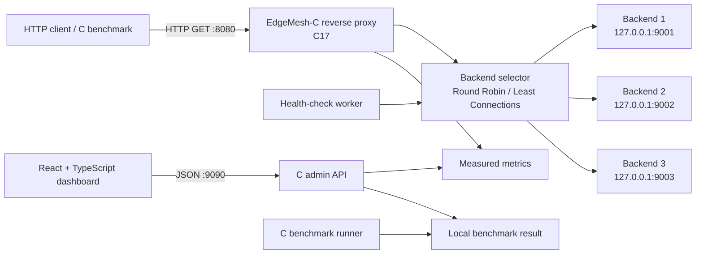

# EdgeMesh-C
### Signal Topography for HTTP traffic

**A C-first, failure-aware HTTP load balancer and reverse proxy with backend health monitoring and performance benchmarking.**

EdgeMesh-C is a Computer Networks systems project focused on what happens between a client and a group of servers: how requests are routed, how unhealthy backends are avoided, and how performance decisions can be measured rather than guessed.

The project combines a native C networking core with a separate React + TypeScript dashboard. Its signature interface visualises the gateway, backend pool, health state and measured traffic distribution.

> **Project status:** M1 is merged. M2 routing and resilience now passes the macOS warnings-as-errors CI suite and is ready for merge in [PR #3](https://github.com/ESpoorthy/EdgeMesh-C/pull/3). The admin API/metrics, benchmark utility and dashboard remain future milestones.

[**Figma UI/UX and design system**](https://www.figma.com/design/cGO3ieo6621gyju6N7yZ2s/edgemesh-c) · [Requirements](docs/requirements.md) · [Architecture](docs/architecture.md) · [API contract](docs/api-contract.md) · [Test plan](docs/test-plan.md)

---

## Why EdgeMesh-C?

A load balancer is an approachable way to explore several important networking concepts in one coherent system:

- **Request routing:** distribute HTTP requests among configured backends using Round Robin or Least Connections.
- **Resilience:** detect backend failures, stop routing new requests to unhealthy servers, and admit them again after successful recovery checks.
- **Observability:** collect actual request, failure, latency and backend metrics.
- **Performance evaluation:** run a repeatable C benchmark client and compare recorded throughput and latency.
- **Design meets systems engineering:** use an editable dashboard to explain the behaviour of the underlying C service.

The goal is not to claim production-grade proxy capability. The goal is to build a bounded, well-tested educational implementation whose behaviour can be demonstrated, measured and explained.

## Product at a glance

| Area | MVP plan |
|---|---|
| Networking core | C17 with POSIX/BSD sockets on macOS |
| Proxy listener | `127.0.0.1:8080` |
| Administrative JSON API | `127.0.0.1:9090` |
| Demo backend pool | `127.0.0.1:9001`, `:9002`, `:9003` |
| Balancing policies | Round Robin and Least Connections |
| Backend management | Periodic health checks, unhealthy-backend exclusion and recovery thresholds |
| Dashboard | React + TypeScript; Overview, Backend Health and Benchmark Lab |
| Build and tests | CMake and CTest |
| Benchmarking | C load generator; recorded results in JSON and/or CSV |

## Architecture

The proxy and administrative API are separate listeners managed by one C application process. Demo backend servers and the benchmark client are separate local processes. The dashboard is a presentation layer; routing decisions and runtime state belong to the C service.



## Dashboard and design

The Figma file is the visual and interaction reference for the three application screens: Overview, Backend Health and Benchmark Lab. Design System and React + TypeScript Handoff are reference frames, not additional app routes.

Prototype fixtures must remain visibly labelled as `PROTOTYPE DATA`. In the integrated application, live values must come from the C API. The first version reads the latest CLI-generated benchmark result; it does not provide an API endpoint to start a run or browse historical runs.

## API contract

The planned admin API is served from `http://127.0.0.1:9090`.

| Method | Route | Purpose |
|---|---|---|
| GET | `/api/v1/health` | Administrative API health |
| GET | `/api/v1/overview` | Proxy readiness, backend summary and aggregate metrics |
| GET | `/api/v1/backends` | Per-backend state, counters, attempt rate and traffic share |
| PUT | `/api/v1/policy` | Set `round_robin` or `least_connections` |
| GET | `/api/v1/metrics?window_seconds=60` | Measured time-series data |
| GET | `/api/v1/benchmarks/latest` | Latest CLI-produced benchmark result, if available |

The API contract documents response fields, units, error envelopes and empty-data behaviour. Administrative API health, proxy readiness, backend health and browser-to-API connectivity are different states and must be shown separately.

## Technology

- **C17** — proxy, demo backends, administrative API and benchmark utility
- **POSIX/BSD sockets + pthreads** — network I/O and concurrency on macOS
- **CMake + CTest** — reproducible builds and automated testing
- **React + TypeScript** — dashboard presentation and API interaction
- **Figma** — visual design, components and developer handoff
- **Wireshark (optional)** — independent inspection of local HTTP traffic during demonstrations

## Build and run

On macOS with Xcode Command Line Tools and CMake installed:

```sh
cmake -S . -B build -DCMAKE_BUILD_TYPE=Debug -DEDGEMESH_ENABLE_WARNINGS_AS_ERRORS=ON
cmake --build build --parallel
ctest --test-dir build --output-on-failure
```

Start three backends in separate terminals, then start the proxy:

```sh
./build/edgemesh-backend --port 9001 --id backend-1
./build/edgemesh-backend --port 9002 --id backend-2
./build/edgemesh-backend --port 9003 --id backend-3
./build/edgemesh-proxy --policy round_robin
curl --include http://127.0.0.1:8080/demo
```

Change the startup routing policy with `--policy least_connections`. Health state starts as unknown and requires two successful probes before a backend receives traffic.

## Security and scope

EdgeMesh-C is a **local educational prototype**.

- Bind listeners to IPv4 loopback by default.
- Restrict upstream destinations to the three configured demo backends; do not create an open proxy.
- Bound request sizes, connection counts, timeouts and retained metrics.
- Validate admin input and restrict browser CORS to the documented development origins.
- CORS and loopback binding are not authentication for other local processes.
- The MVP intentionally excludes TLS termination, HTTP/2, WebSockets, persistent client connections, request-body forwarding, Kubernetes and cloud deployment.

Do not expose the admin API publicly or use the prototype as an internet-facing production proxy.

## Development roadmap

M1 and M2 are complete in code; M2's latest source and tests are verified by the macOS CI run linked in [PR #3](https://github.com/ESpoorthy/EdgeMesh-C/pull/3). A milestone is only complete once its implementation and relevant tests pass.

- [x] **M1 — Working C foundation:** CMake project, demo backend, basic proxy and focused tests.
- [x] **M2 — Routing and resilience:** Round Robin, Least Connections, bounded concurrency, health checks, failover and recovery.
- [ ] **M3 — Admin API and metrics:** six documented endpoints and real runtime measurements.
- [ ] **M4 — Benchmarking:** load generator, result validation and JSON/CSV output.
- [ ] **M5 — Dashboard integration:** implement the approved Figma screens against live API data.
- [ ] **M6 — Validation and demo:** failure tests, reproducible benchmarks, documentation and demonstration evidence.

## Repository map

```text
EdgeMesh-C/
├── AGENTS.md
├── README.md
├── LICENSE
├── CMakeLists.txt
├── docs/
│   ├── requirements.md
│   ├── architecture.md
│   ├── api-contract.md
│   ├── milestone-1.md
│   ├── milestone-2.md
│   └── milestone-3-handoff.md
├── include/edgemesh/
├── src/
├── tests/
├── benchmark/
├── dashboard/
└── results/
```

## Contributing and team workflow

Read `AGENTS.md` and the four specification documents before implementation. Keep changes reviewable, do not invent API routes, and update documentation when implementation changes require it.

For every milestone, report changed files, actual commands and test results, and known limitations. Never claim a build, test, benchmark or feature passed without evidence.

## License

EdgeMesh-C is distributed under the [MIT License](LICENSE).
