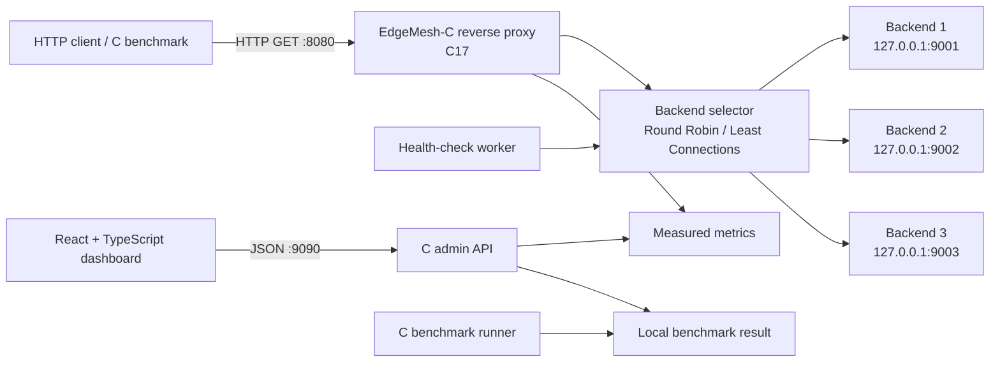

# EdgeMesh-C
### Signal Topography for HTTP traffic

**A C-first, failure-aware HTTP load balancer and reverse proxy with backend health monitoring and performance benchmarking.**

EdgeMesh-C is a Computer Networks systems project focused on what happens between a client and a group of servers: how requests are routed, how unhealthy backends are avoided, and how performance decisions can be measured rather than guessed.

The project combines a native C networking core with a separate React + TypeScript dashboard. Its signature interface visualises the gateway, backend pool, health state and measured traffic distribution.

> **Project status:** The MVP specification and design handoff are established. Implementation is being developed in milestones. Features described below are planned until their code and tests are committed; this README will be updated as milestones become runnable.

[**Figma UI/UX and design system**](https://www.figma.com/design/cGO3ieo6621gyju6N7yZ2s/edgemesh-c) · [Requirements](docs/requirements.md) · [Architecture](docs/architecture.md) · [API contract](docs/api-contract.md) · [Test plan](docs/test-plan.md)

---

## Why EdgeMesh-C?

A load balancer is an approachable way to explore several important networking concepts in one coherent system:

- **Request routing:** distribute HTTP requests among configured backends using Round Robin or Least Connections.
- **Resilience:** detect backend failures, stop routing new requests to unhealthy servers, and admit them again after successful recovery checks.
- **Observability:** collect actual request, failure, latency and backend metrics.
- **Performance evaluation:** run a repeatable C benchmark client and compare recorded throughput and latency.
- **Design meets systems engineering:** use an editable dashboard to explain the behaviour of the underlying C service.

The goal is not to claim production-grade proxy capability. The goal is to build a bounded, well-tested educational implementation whose behaviour can be demonstrated, measured and explained.

## Product at a glance

| Area | MVP plan |
|---|---|
| Networking core | C17 with POSIX/BSD sockets on macOS |
| Proxy listener | `127.0.0.1:8080` |
| Administrative JSON API | `127.0.0.1:9090` |
| Demo backend pool | `127.0.0.1:9001`, `:9002`, `:9003` |
| Balancing policies | Round Robin and Least Connections |
| Backend management | Periodic health checks, unhealthy-backend exclusion and recovery thresholds |
| Dashboard | React + TypeScript; Overview, Backend Health and Benchmark Lab |
| Build and tests | CMake and CTest |
| Benchmarking | C load generator; recorded results in JSON and/or CSV |

## Architecture

The proxy and administrative API are separate listeners managed by one C application process. Demo backend servers and the benchmark client are separate local processes. The dashboard is a presentation layer; routing decisions and runtime state belong to the C service.



### Request lifecycle

1. A client sends a supported HTTP GET request to the proxy.
2. The C proxy validates the request and selects an eligible healthy backend.
3. The request is forwarded to that configured backend, and its response is returned to the client.
4. Health checks update backend availability; failures remove backends from new selections until recovery criteria are met.
5. The service records real counters and latency samples.
6. The dashboard queries the local admin API, while the benchmark client saves its own completed run.

## Planned dashboard

The Figma file is the visual and interaction reference for the three application screens.

- **Overview** — service/proxy state, request KPIs, traffic topology, request rate and latency.
- **Backend Health** — backend state, active connections, request statistics and balancing-policy selection.
- **Benchmark Lab** — the latest saved benchmark result, completion/failure counts, throughput and latency percentiles.

The Design System and React + TypeScript Handoff frames are implementation references, not additional application routes.

Prototype fixtures must remain visibly labelled as `PROTOTYPE DATA`. In the integrated application, live values must come from the C API. The first version reads the latest CLI-generated benchmark result; it does not provide an API endpoint to start a benchmark or browse historical runs.

## API contract

The planned admin API is served from `http://127.0.0.1:9090`.

| Method | Route | Purpose |
|---|---|---|
| GET | `/api/v1/health` | Administrative API health |
| GET | `/api/v1/overview` | Proxy readiness, backend summary and aggregate metrics |
| GET | `/api/v1/backends` | Per-backend state, counters, attempt rate and traffic share |
| PUT | `/api/v1/policy` | Set `round_robin` or `least_connections` |
| GET | `/api/v1/metrics?window_seconds=60` | Measured time-series data |
| GET | `/api/v1/benchmarks/latest` | Latest CLI-produced benchmark result, if available |

The API contract documents response fields, units, error envelopes and empty-data behaviour. Administrative API health, proxy readiness, backend health and browser-to-API connectivity are different states and must be shown separately.

## Technology

- **C17** — proxy, demo backends, administrative API and benchmark utility
- **POSIX/BSD sockets + pthreads** — network I/O and concurrency on macOS
- **CMake + CTest** — reproducible builds and automated testing
- **React + TypeScript** — dashboard presentation and API interaction
- **Figma** — visual design, components and developer handoff
- **Wireshark (optional)** — independent inspection of local HTTP traffic during demonstrations

## Build and run

The CMake project and executable targets are being implemented incrementally. **Build and run commands will be published here once the first working implementation milestone is committed and verified.** Until then, refer to [the test plan](docs/test-plan.md) for the intended build/test workflow; it describes planned commands, not completed test results.

The intended development checks are:

```sh
cmake -S . -B build -DCMAKE_BUILD_TYPE=Debug
cmake --build build --parallel
ctest --test-dir build --output-on-failure
```

No build or test result should be inferred from the presence of these commands. See the latest commits and pull requests for the implementation state.

## Security and scope

EdgeMesh-C is a **local educational prototype**.

- Bind the proxy and admin API to IPv4 loopback by default.
- Restrict upstream destinations to the three configured demo backends; do not create an open proxy.
- Bound request sizes, connection counts, timeouts and retained metrics.
- Validate admin input and restrict browser CORS to the documented development origins.
- CORS and loopback binding are not authentication for other local processes.
- The MVP intentionally excludes TLS termination, HTTP/2, WebSockets, persistent client connections, request-body forwarding, Kubernetes and cloud deployment.

Do not expose the admin API publicly or use the prototype as an internet-facing production proxy.

## Development roadmap

Implementation is planned in reviewable milestones:

- [ ] **M1 — Working C foundation:** CMake project, demo backend, basic proxy and focused tests.
- [ ] **M2 — Routing and resilience:** Round Robin, Least Connections, health checks and failover.
- [ ] **M3 — Admin API and metrics:** six documented endpoints and real runtime measurements.
- [ ] **M4 — Benchmarking:** load generator, result validation and JSON/CSV output.
- [ ] **M5 — Dashboard integration:** implement the approved Figma screens against live API data.
- [ ] **M6 — Validation and demo:** failure tests, reproducible benchmarks, documentation and demonstration evidence.

Roadmap items should be marked complete only after the implementation exists and its relevant tests have been run.

## Repository map

```text
EdgeMesh-C/
├── AGENTS.md
├── README.md
├── LICENSE
├── CMakeLists.txt
├── docs/
│   ├── requirements.md
│   ├── architecture.md
│   ├── api-contract.md
│   └── test-plan.md
├── include/
├── src/
├── tests/
├── benchmark/
├── dashboard/
└── results/
```

This is the intended structure; folders and source targets will appear as their milestones are implemented.

## Contributing and team workflow

Keep changes small and reviewable. Read `AGENTS.md` and the four specification documents before implementation. Keep the C core separate from the dashboard, do not invent new API routes independently, and update the documentation when a contract change is necessary.

For each change, report the files modified, commands actually run, test results and remaining limitations. Never claim a build, test, benchmark or feature passed without evidence.

## License

EdgeMesh-C is distributed under the [MIT License](LICENSE).
